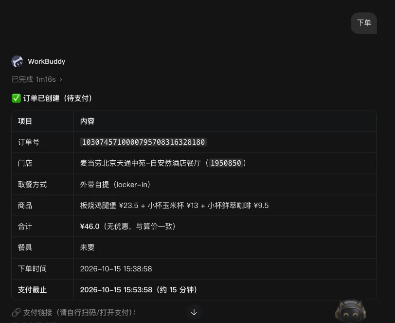
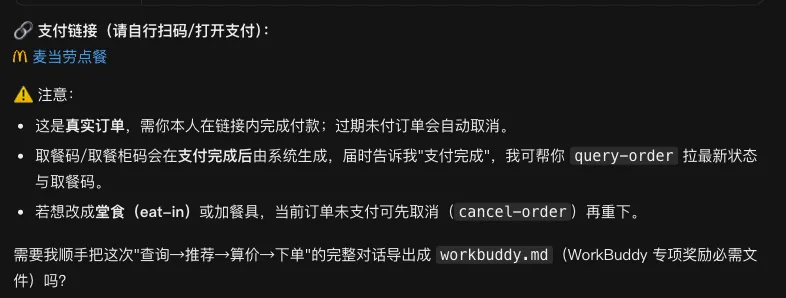
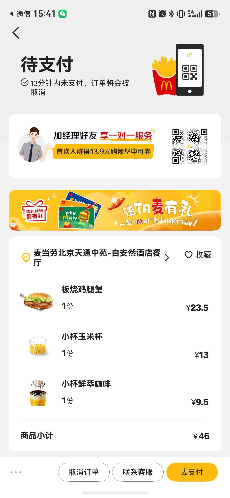

# 麦麦减脂私教 McFit Coach

> 麦当劳程序员创意开发大赛（1024 程序员节）参赛作品 · 形态：**WorkBuddy Skill + 麦当劳 MCP**，无后端、纯编排。
> GitHub 仓库根目录即本文件夹（含 `SKILL.md` 与 `references/`）。

## 一句话定位
不是"推荐套餐"，而是**按用户的热量 / 蛋白质 / 钠 预算，反向造出一份能直接下单的麦当劳餐，并自动用券算出最低到手价**。

## 功能特性（F1–F8）
- **F1 时段识别**：早/午/晚/夜市分流。
- **F2 营养解析**：把官方 `list-nutrition-foods` 的非 JSON（TOON）解析为结构化营养表。
- **F3 选店拉菜单**：默认北京（用户可改城市），到店/外送选店并拉可售餐品与价格。
- **F4 套餐件替换**：拆套餐、把高热量件换低热量件——**去酱**（走 modification）、**可乐→无糖**（同轮零加价）。
- **F5 组合约束求解**：本地枚举「主餐×小食×饮品」，按热量/蛋白/钠过滤，输出达标 Top-K；无解自动给近似方案。
- **F6 优惠券匹配与最低价**：拉门店券+账户券，算带券最低到手价。
- **F7 一键下单**：用户确认后调 `create-order`，返回支付链接（由用户自行支付）。
- **F8 麦麦体检卡**（增强）：读近 10 笔历史订单，生成"本周营养账单"可分享图。

## 安装方法
### 1. 获取麦当劳 MCP Token
前往 `open.mcd.cn/mcp`，用手机号登录 → 控制台 → 激活，获取 Bearer Token。

### 2. 配置 MCP
将 `mcp-config.example.json` 中的 `${MCD_MCP_TOKEN}` 替换为你的 Token，合并进 WorkBuddy 的 `~/.workbuddy/mcp.json`：

```json
{
  "mcpServers": {
    "mcd-mcp": {
      "type": "streamablehttp",
      "url": "https://mcp.mcd.cn",
      "headers": { "Authorization": "Bearer ${MCD_MCP_TOKEN}" }
    }
  }
}
```

### 3. 导入技能
将本仓库（含 `SKILL.md` 与 `references/`）作为**本地用户技能**导入 WorkBuddy（专家/技能 → 导入本地技能）。

## 使用示例
**场景 A · 减脂**
```
用户：北京，帮我点一份板烧鸡腿堡三件套，去酱、饮料换无糖可乐
→ 方案：板烧鸡腿堡三件套(去酱) + 中薯条 + 无糖可口可乐中杯
→ 营养：约 680 大卡 · 蛋白 27g · 钠 1241mg
→ 到手价：¥52.5（券：无）
→ [一键下单]（用户确认后真实下单，返回支付链接）
```
**场景 B · 儿童低钠 / 场景 C · 麦麦体检卡** 详见 `项目规划说明书.md`。

## 目标用户
- 减脂 / 控糖人群
- 关注儿童低钠的家长
- 想"吃得明白、花得最少"的麦当劳常客

## 技术架构
- **WorkBuddy Skill**：`SKILL.md` 定义触发与编排，`references/` 放本地算法脚本（不依赖外部算力）。
- **麦当劳 MCP**（`mcp.mcd.cn`，Streamable HTTP）：全部能力来自官方 Tool，零自建后端。
- **安全合规**：不存储用户数据；不下场支付；仅生成可下单方案与支付链接；`create-order` 须用户显式授权。

## 目录结构
```
.
├── SKILL.md                  # 技能主文件（触发 / 编排 / 输出格式）
├── README.md                 # 本文件
├── MCP_INTEGRATION.md        # 麦当劳 MCP 接入说明
├── mcp-config.example.json   # MCP 配置示例（仅占位符）
├── CONTEST_DECLARATION.md    # 参赛声明（官方原样，不可改）
├── 项目规划说明书.md           # 立项计划
├── 物料清单.md                # 开发物料与决策项
├── MCP接口实测.md             # 真实接口样本与关键约束
├── workbuddy.md              # WorkBuddy 开发对话上下文
└── references/
    ├── toon_parser.py        # TOON 营养文本解析（已验证）
    ├── combo_solver.py       # 组合约束求解（已验证）
    ├── toon_sample.txt       # 营养样本
    └── nutrition_index.sample.json
```

## 免责声明
营养数值以官方实时接口为准；本技能结论仅供参考，**不构成营养/医疗建议**。

## 项目执行效果实测


下面用一次真实对话验证完整链路。用户输入：

```text
查询天通苑附近的店铺，并给我推荐一份套餐。
```

Skill 首先查询附近门店，再结合当前时段拉取菜单并生成推荐结果。


确认推荐内容后，继续输入下单指令。由于这是一次真实写操作，Skill 会等待明确确认，再调用 `create-order`。





打开返回的支付链接后，页面会展示付款二维码。


使用手机扫码后，可以看到推荐商品已经加入购物车，核对订单后即可完成支付。



这次联调验证了“查门店—推荐套餐—用户确认—创建订单—跳转支付”的闭环。它也说明，LLM 在这个项目中负责理解需求和编排流程，真正决定菜单、价格与订单状态的仍然是 MCP 提供的实时业务接口。
